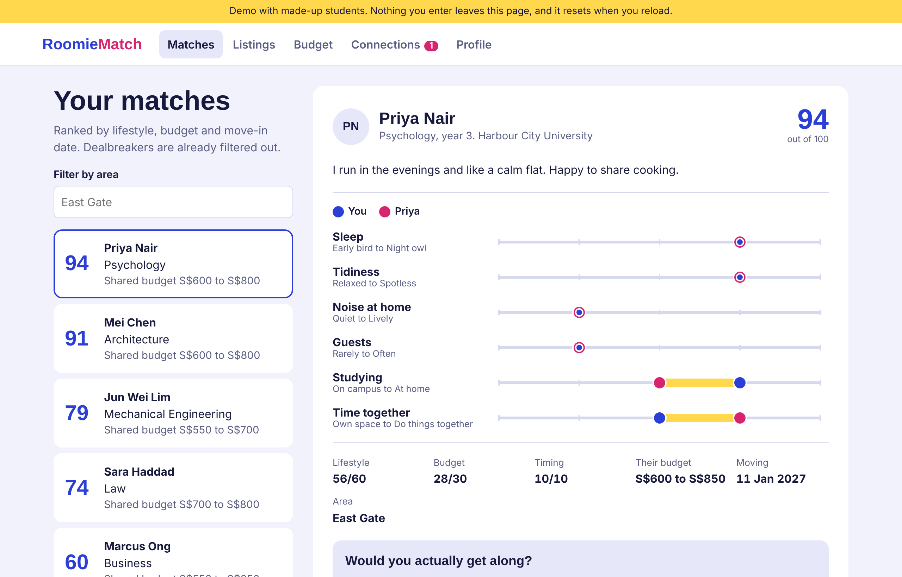
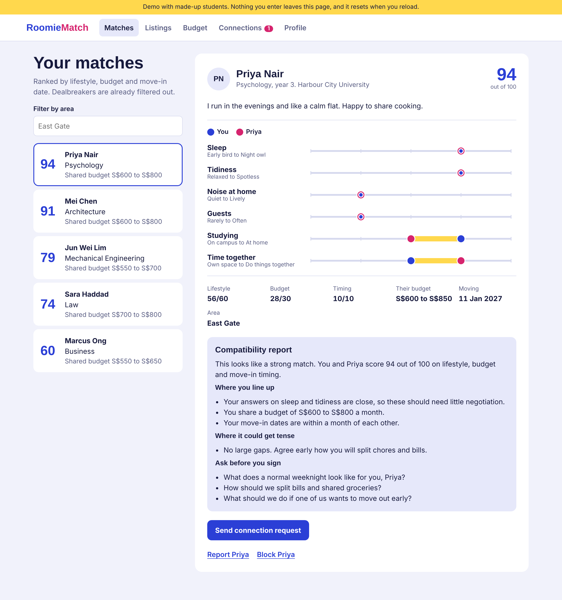
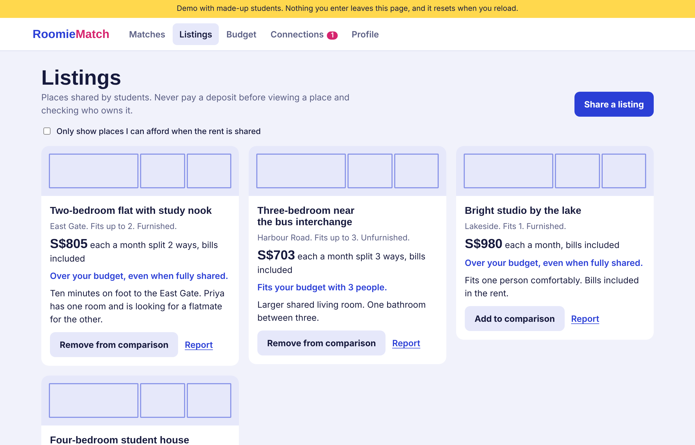
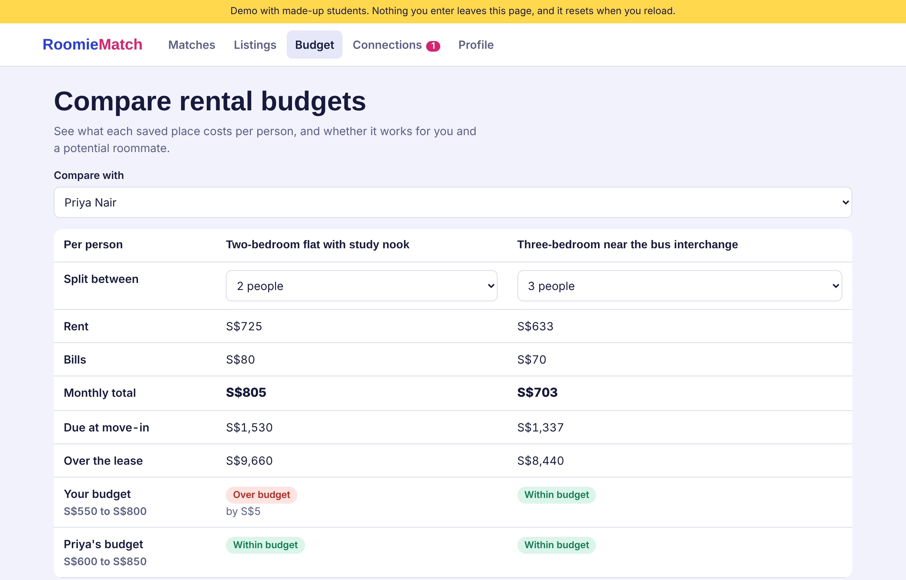
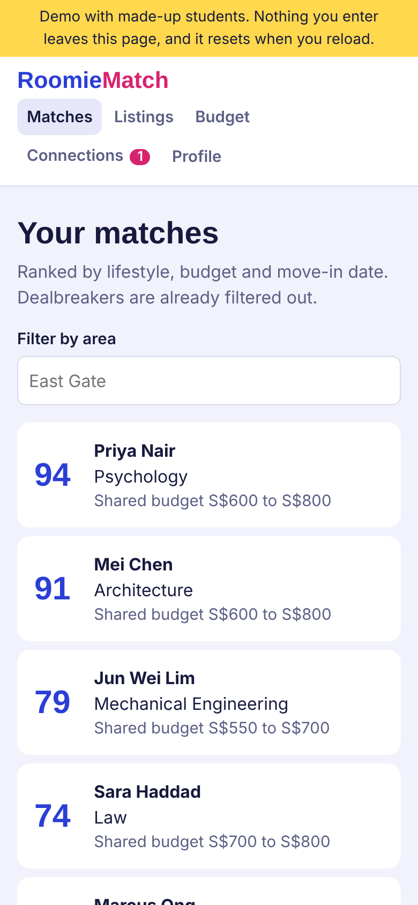

# RoomieMatch

RoomieMatch helps university students find a compatible roommate and a place to live. Students fill in a
profile about how they live, then see other students ranked by lifestyle, budget and move-in date.

**Live app:** https://rommiematch.vercel.app



## Project overview

Finding a roommate usually means guessing from a short message or a social media post. RoomieMatch asks
both students the same questions about sleep, tidiness, noise, guests, studying and time together, then
shows exactly where they agree and where they differ. Dealbreakers such as smoking or pets remove a match
completely, so students only see people they could realistically live with.

This is a student prototype.

## Features

- **Student profiles:** lifestyle answers on a 1 to 5 scale, budget range, preferred area, move-in date and
  dealbreakers.
- **Roommate matching:** each match gets a score out of 100. Lifestyle counts for 60 points, budget for 30
  and move-in timing for 10.
- **Compatibility report:** a written summary of where two students line up, what could cause friction and
  what to ask each other before signing a lease. It is built from both students' answers, with no AI service.
- **Accommodation listings:** students share places with rent, bills, deposit and photos, save them, and
  report suspicious listings.
- **Budget comparison:** saved places are compared per person, against your budget and a potential
  roommate's budget.
- **Private contact details:** contact details stay hidden until both students accept a connection.
- **Safety tools:** students can block or report each other.

## Screenshots

| Compatibility report | Listings |
|---|---|
|  |  |

| Budget comparison | Mobile |
|---|---|
|  |  |

## Tech stack

- **Frontend:** React 18, TypeScript and Vite
- **Backend:** Supabase (Postgres database, authentication, file storage for listing photos)
- **Security:** Postgres Row Level Security policies control who can read and change each row
- **Testing:** Vitest, with PGlite to run the real database migration and test the access rules
- **Hosting:** Vercel

## Setup instructions

### 1. Run it on your computer

You need [Node.js](https://nodejs.org) 20 or newer.

```bash
npm install
npm run dev
```

Open the link shown in the terminal, usually http://localhost:5173. With no Supabase keys, the app runs on
made-up sample students.

### 2. Connect Supabase

1. Create a free project at [supabase.com](https://supabase.com).
2. Open **SQL Editor**, paste the contents of `supabase/migrations/0001_init.sql`, and click **Run** once.
3. Copy `.env.example` to a new file named `.env` and fill it in:

   ```
   VITE_SUPABASE_URL=https://your-project.supabase.co
   VITE_SUPABASE_ANON_KEY=your_publishable_key
   VITE_CURRENCY_SYMBOL=S$
   ```

   Use the **publishable** key. Never put the secret key in `.env`, because these values are visible in the
   browser.
4. Run `npm run dev` again.

### 3. Deploy to Vercel

```bash
npx vercel login
npx vercel --prod --build-env VITE_SUPABASE_URL='your_url' --build-env VITE_SUPABASE_ANON_KEY='your_publishable_key' --build-env VITE_CURRENCY_SYMBOL='S$'
```

Then, in Supabase, go to **Authentication > URL Configuration** and set **Site URL** to your Vercel link.

### 4. Run the tests

```bash
npm test
```

## Project structure

```
src/screens                  App pages: matches, listings, budget, connections, profile
src/lib/compatibility.ts     Builds the compatibility report
src/lib/supabaseApi.ts       Calls to Supabase
src/lib/demoApi.ts           Sample data mode
supabase/migrations          Database tables and access rules
supabase/functions/_shared   Matching and scoring logic
tests                        Logic and database access tests
```

## Before real students use it

- Limit sign-ups to university email addresses.
- Check the `reports` table regularly, because nobody is notified of new reports.
- Add terms of use and a privacy notice. In Singapore, the PDPA may apply.
